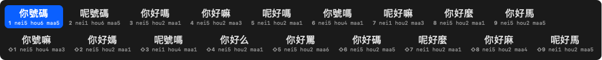

# 粵拼 Cantainput

Mac 粵語拼音（粵拼／Jyutping）輸入法。自己寫嘅 Swift ranking engine（唔靠 librime），
本機學習你常用嘅字詞，目標係「打得快過而家」。

## 狀態（v1.1）

- [x] 詞庫：138,732 條（字／詞／phrase／英文／地名），由 rime-cantonese + rime-essay 編譯
- [x] 引擎：**Viterbi 整句解碼**（音節格 + beam search）、wordBonus、粵字 prior、個人學習加權
- [x] 候選窗：18 個、兩行、每個候選下面標粵拼讀音、即時整句預覽
- [x] IMK host：inline marked text、自製候選窗（唔用 IMKCandidates）
- [x] 學習紀錄：`~/Library/Application Support/Cantainput/learning.json`
- [ ] 首次註冊：macOS 要 **logout / login 一次** 之後，新 IME 才會出現在 Input Sources
- [ ] 未做：打錯字容錯（edit distance）、bigram 詞頻
- [ ] 未試：真正喺 app 入面打字（等上面嗰步）



## 安裝

```bash
tools/fetch_data.sh          # 下載上游詞庫（唔會 commit）
python3 tools/build_lexicon.py
tools/build.sh
tools/install.sh             # 裝去 ~/Library/Input Methods
```

然後 **logout 再 login**（或用 `tools/verify.sh` 睇下認唔認到），
去 系統設定 → 鍵盤 → 輸入方式 → `+` → 中文（繁體）→「粵拼 Cantainput」。

更新版本（已經註冊過之後）唔需要再 logout：

```bash
tools/build.sh && tools/install.sh && open "$HOME/Library/Input Methods/Cantainput.app"
```

## 用法

- 打粵拼字母：`nei` → 你、`ngodei` → 我哋、`gamjattinheihouhou` → 今日天氣好好
- 成句一齊打都得：打落去會即時預覽最似嘅整句，`space` / `enter` 一次過上屏
- 聲調可加可唔加：`ngo4` 只出四聲
- 候選 18 個、分兩行；大字上面，**下面係嗰個候選嘅粵拼讀音**
- `1`–`9` 揀第一行，`Shift`+`1`–`9` 揀第二行，`←`/`→`/`↑`/`↓` 揀，`esc` 取消
- 打過嘅字詞會慢慢排前（per-user，唔會離開你部機）

## 自我測試

```bash
./build/Cantainput.app/Contents/MacOS/Cantainput --selftest
```

## 資料來源同授權

- 詞庫：[rime-cantonese](https://github.com/rime/rime-cantonese)（CC BY 4.0）
- 頻率：[rime-essay](https://github.com/rime/rime-essay)（LGPL-3.0）— **只用嚟 build，唔入 repo、唔隨 app 派**
- 地名 `maps` 表：OpenStreetMap，ODbL-1.0

因為頻率表嘅授權，`Data/` 同 `Resources/jyutping.tsv` 都唔會 commit；
公開派街之前要換一個乾淨嘅頻率來源，詳情見 [docs/spec.md](docs/spec.md)。

## 結構

```
Sources/CantainputCore/   Lexicon（詞庫）、Engine（排序）、Learning（學習）
Sources/Cantainput/       IMK host、候選窗、Info.plist
tools/                    fetch_data.sh / build_lexicon.py / build.sh / install.sh / verify.sh
docs/spec.md              設計、排序公式、已知限制、路線圖
```
